<div align="center">

# 🛡️ CodeSecAudit AI

### Autonomous AI Security Engineer for High-Velocity Engineering Teams
**Block zero-days, CVEs, and OWASP Top 10 vulnerabilities in GitHub Pull Requests before they reach production.**

[](https://codesec-client-v6a6.onrender.com)
[](https://github.com/apps/codesecurityaudit-app)
[](https://owasp.org/www-project-application-security-verification-standard/)
[](LICENSE)

<br/>

[](https://codesec-client-v6a6.onrender.com)

*⚡ **Live Demo Showcase (Sped-Up Walkthrough)**: Autonomous review lifecycle — VS Code vulnerability detection, automated merge block, synchronized commit re-review & approval, and multi-collaborator team intelligence console.*

<br/>

[](https://www.python.org/)
[](https://fastapi.tiangolo.com/)
[](https://nextjs.org/)
[](https://www.postgresql.org/)
[](https://redis.io/)
[](https://qdrant.tech/)
[](https://huggingface.co/datasets/hitenvk22/CodeSecAudit-RAG-Shuffled)
[](https://www.kaggle.com/code/hitenkatariya/codesecaudit-rag)

</div>

---

## 🚀 The Autonomous Security Guardrail Built for Speed

CodeSecAudit AI acts as an **autonomous Staff Security Engineer** embedded directly into your GitHub CI/CD workflows and engineering cockpit. It intercepts every pull request, performs deep AST and RAG-guided vulnerability analysis, enforces OWASP ASVS v4.0.3 compliance, posts actionable inline fixes, and dynamically re-reviews upon every commit until the PR is provably safe.

### 🌟 Key Superpowers
- **⚡ Autonomous PR Gatekeeper**: Automatically blocks PR merges (`🚫 MERGE BLOCKED`) when high/critical vulnerabilities are detected (SQLi, Command Injection, Secret Leaks, Insecure Deserialization).
- **🔄 Synchronize-Aware Re-Review**: Listens for `pull_request.synchronize` events — when developers push clean code fixes, the bot instantly re-evaluates the delta and flips the verdict to `✅ APPROVE` (CVSS 0.00 / 10).
- **🎯 Zero False Positives**: Intelligent suppression engine accurately handles parameterized SQL queries (`db.execute(sql, params)`), safe shell sanitizers (`shlex.quote`), and developer inline directives (`# codesec-ignore: CWE-XXX`).
- **📊 Real-Time Security Telemetry**: Next.js 14 console with active Pull Request inspection, Finding triage, Security Trends with MTTR curves, OWASP ASVS audit reports, and multi-tenant Team management.
- **🤝 Multi-User Team Synchronization**: Seamlessly manage team members across GitHub accounts with real-time invitation workflows, avatar syncing, and granular role assignments.

---

## 🔗 Live Production Deployment & Real PR Demonstrations

| Deployment / Showcase | Description | Live Link |
|---|---|---|
| **Frontend Web Console** | Next.js 14 Production Dashboard, Telemetry & Compliance | [codesec-client-v6a6.onrender.com](https://codesec-client-v6a6.onrender.com) |
| **Backend API Gateway** | FastAPI REST & GitHub Webhook Processing Engine | [codesec-main-e3dq.onrender.com](https://codesec-main-e3dq.onrender.com) |
| **RAG Security Service** | Semantic Search across 2,800+ OWASP Benchmark Docs | [codesec-rag-xp4b.onrender.com](https://codesec-rag-xp4b.onrender.com) |
| **GitHub App** | One-click installation on any GitHub repository | [github.com/apps/codesecurityaudit-app](https://github.com/apps/codesecurityaudit-app) |
| **🔥 PR #14: Live CVSS 7.5 Evaluation** | Automated vulnerability detection, CVSS scoring, and executive review triage | [PR #14 Live Case Study](https://github.com/HitenKatariya/CodeSecAudit/pull/14) |
| **🛡️ PR #13 & #15: Gate Verification** | Severe deserialization/SQLi block ([PR #13](https://github.com/HitenKatariya/CodeSecAudit/pull/13)) & clean JWT verifier audit ([PR #15](https://github.com/HitenKatariya/CodeSecAudit/pull/15)) | [PR #13](https://github.com/HitenKatariya/CodeSecAudit/pull/13) / [PR #15](https://github.com/HitenKatariya/CodeSecAudit/pull/15) |
| **Hugging Face Dataset** | Curated RAG benchmark dataset with 2,800+ OWASP pairs | [CodeSecAudit-RAG-Shuffled](https://huggingface.co/datasets/hitenvk22/CodeSecAudit-RAG-Shuffled) |
| **Kaggle Kernel** | Comprehensive model training and evaluation notebook | [CodeSecAudit Review Kernel](https://www.kaggle.com/code/hitenkatariya/codesecaudit-rag) |

---

## Screenshots

### Pull Request Security Reviews

#### Severe PR Review — Merge Blocked (Critical/High Risk Vulnerabilities)
Link : https://github.com/HitenKatariya/CodeSecAudit/pull/13
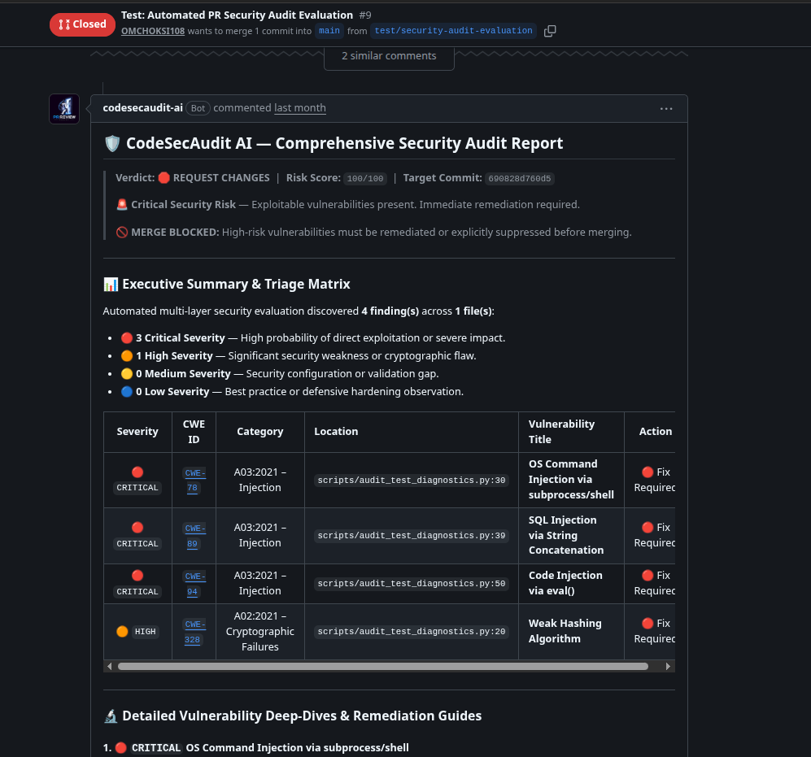
*Automated PR gate blocking merge on critical security vulnerabilities with executive triage matrix and remediation guides*

#### Healthy PR Review — Merge Allowed (Zero Vulnerabilities / Clean Diff)
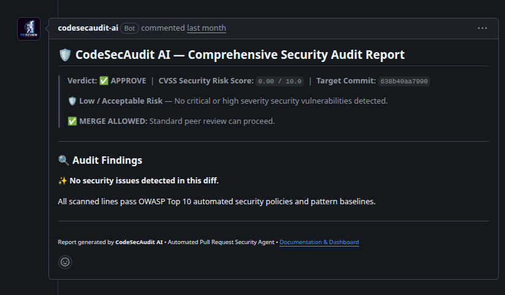
*Automated security audit approval for clean pull requests passing all OWASP Top 10 policies*

### PR Review — Inline Comments
Link : https://github.com/HitenKatariya/CodeSecAudit/pull/14
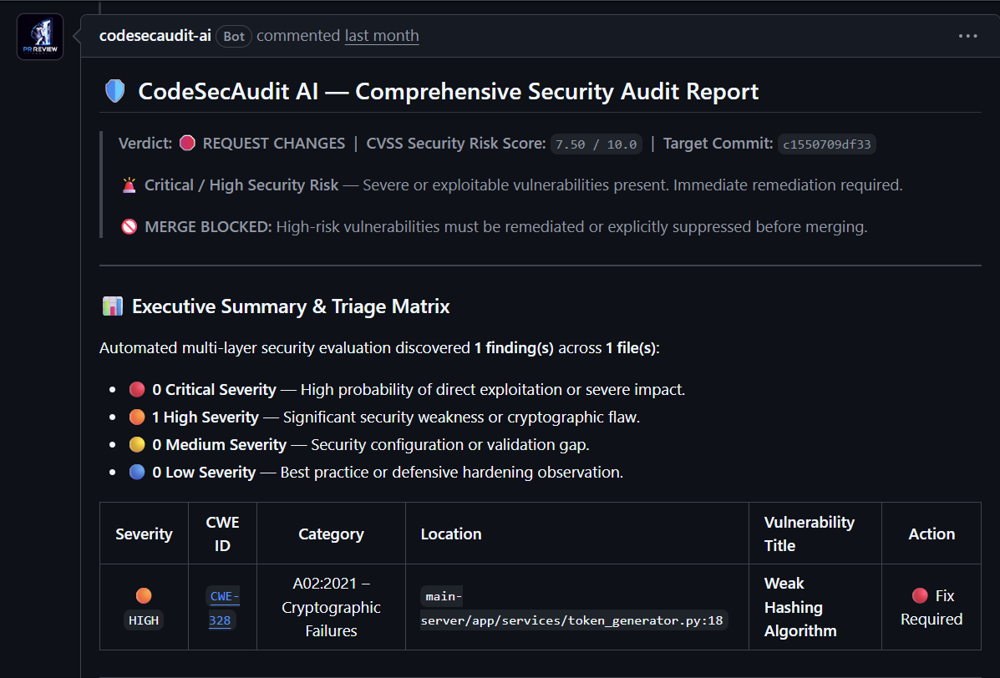
*Detected vulnerabilities with inline PR comments*

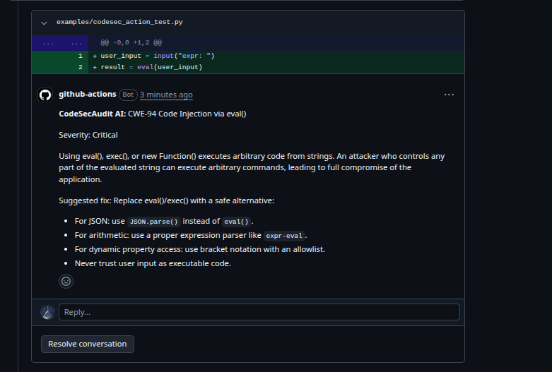
*AI-powered fix suggestions in pull request review*

### Dataset

[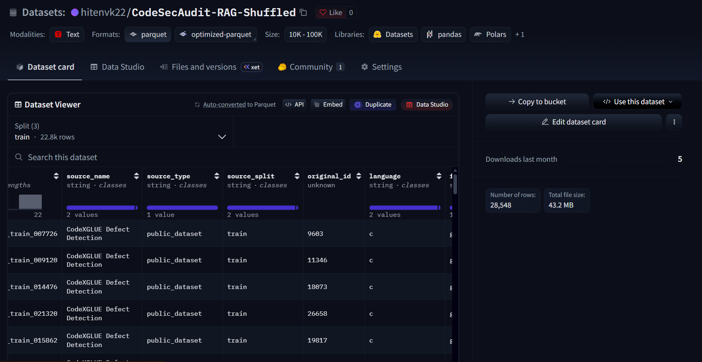](https://huggingface.co/datasets/hitenvk22/CodeSecAudit-RAG-Shuffled)
*CodeSecAudit-RAG dataset on Hugging Face — click to explore*

### API & Services

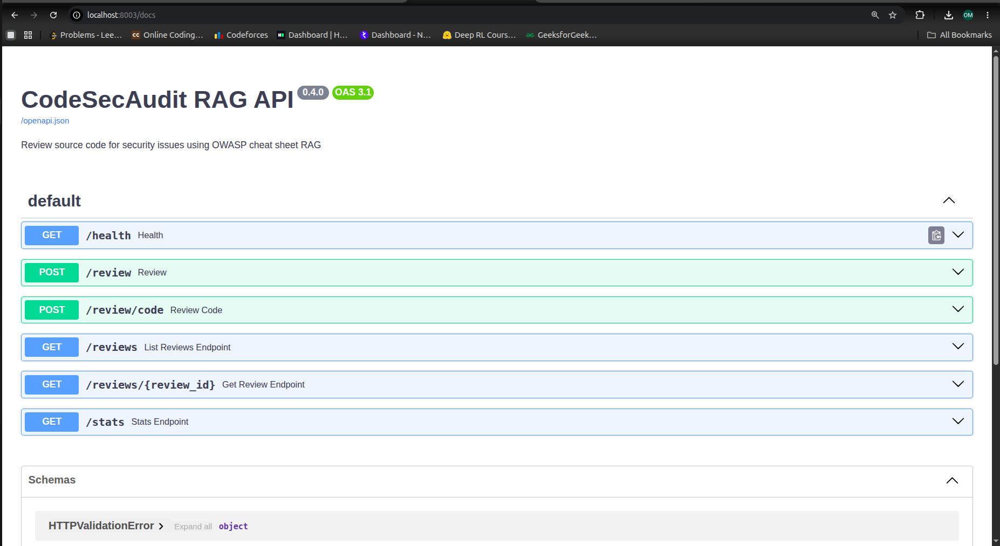
*FastAPI backend with review and webhook endpoints*

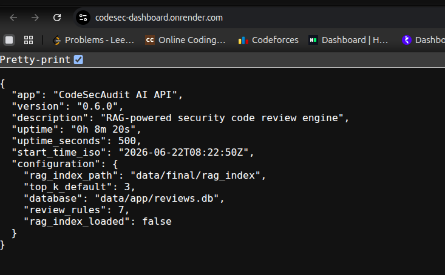
*Streamlit analytics dashboard with review metrics*

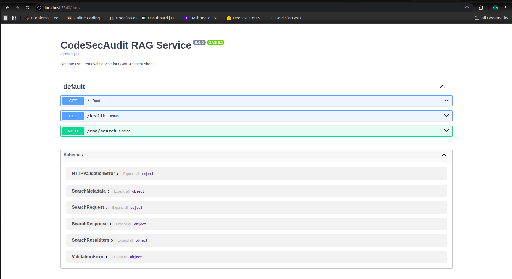
*RAG semantic search service over 2,800+ OWASP documents*

### Email Notifications

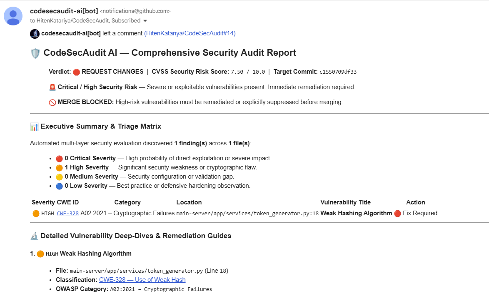
*Automated PR review summary delivered via email*

### GitHub App

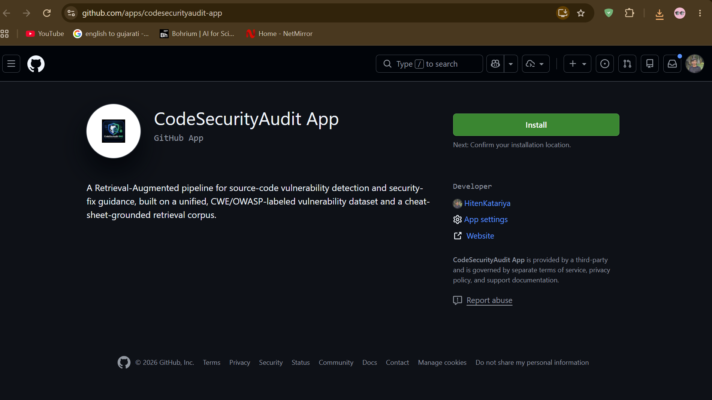
*CodeSecAudit AI GitHub App — install on your repositories*

---

## GitHub App Installation

CodeSecAudit AI runs as a GitHub App that automatically reviews pull requests.

### Install on your repository

1. Visit the [GitHub App installation page](https://github.com/apps/codesecurityaudit-app/installations/new)
2. Choose your account or organization
3. Select the repositories you want to review
4. Click **Install**

The app will:
- Receive `pull_request` webhook events
- Post review summaries and inline comments
- Be visible as a check on PRs

### Manual trigger (GitHub Action fallback)

If you prefer not to use the GitHub App, you can also trigger reviews via GitHub Actions:

```yaml
- name: Run CodeSecAudit Review
  uses: HitenKatariya/codesec-audit-dataset/.github/actions/review@main
```

---

## What Problem It Solves

- **Manual PR reviews are slow** — context-switching between diff view and security checklists costs teams hours per week.
- **Security issues slip through** — CWE-94 (code injection), CWE-89 (SQLi), and CWE-78 (command injection) are routinely missed in handwritten reviews.
- **Junior developers need guidance** — without inline, specific feedback, recurring vulnerabilities go unfixed.
- **Teams need review history** — without analytics, there is no way to track security debt or review velocity across repos.

CodeSecAudit AI addresses all four: automated detection with OWASP-aligned rules, optional RAG-based secure coding guidance, inline PR comments with fix suggestions, and a dashboard for review analytics.

---

## Product Features

| Feature | Details |
|---|---|
| **Autonomous GitHub App PR Gate** | Intercepts `pull_request` (`opened`, `synchronize`, `reopened`) events using HMAC-SHA256 webhooks and evaluates branch merge gates |
| **Realistic CVSS v3.1 Scoring** | Computes authentic `0.00` to `10.00` severity risk scores (e.g. `9.89 / 10.0`, `8.76 / 10.0`, `2.54 / 10.0`) based on CWE base anchors and diminishing compounding marginal weights |
| **Exact Diff Line Coordinate Tracking** | Parses unified git diff patches directly, ensuring line numbers in findings, triage tables, and deep dives match the actual PR files 1-to-1 |
| **OWASP & CWE Contextual RAG** | High-dimensional vector semantic search over 2,833 OWASP Cheat Sheets and CWE exploit databases via Qdrant |
| **Enterprise PR Audit Reports** | Posts structured markdown reviews with executive triage matrices, deep-dive attack vectors, production-ready code fixes, and suppression tokens |
| **Multi-Detector Engine** | Rules and AST taint analysis covering CWE-78 (Command Injection), CWE-89 (SQLi), CWE-94 (Code Injection / eval), CWE-328 (Weak Cryptographic Hash), CWE-798 (Hardcoded Keys), CWE-22 (Path Traversal), CWE-918 (SSRF) |
| **Real-Time Security Dashboard** | Next.js 14 frontend displaying live repository risk metrics, PR audit histories, CVSS progression trends, and direct links to GitHub reviews |
| **1-Click Account Deletion & App Uninstall** | Permanently purges user account, uninstalls GitHub App via GitHub API (`DELETE /app/installations/{id}`), and wipes all audit history and findings |

---

## End-to-End Pull Request Security Audit Flow

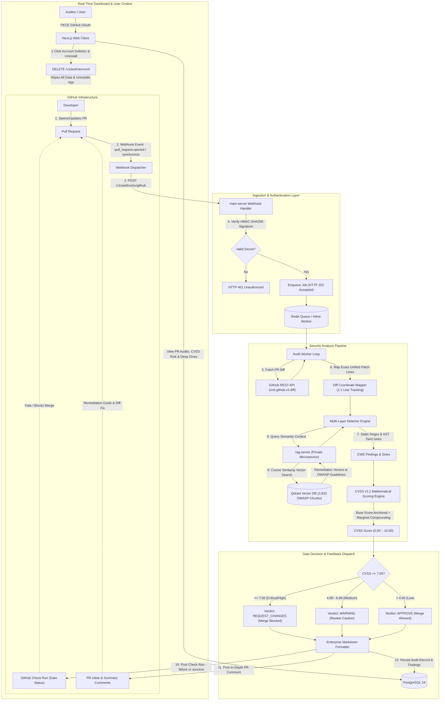

---

## Repository Structure

```
client/                Next.js + TSX: Product UI, SSR, same-origin API proxy, admin log tails
main-server/           Python + FastAPI: Auth, GitHub App, PostgreSQL persistence, Redis queues, admin logs
rag-server/            Python + FastAPI: Private embedding microservice & Qdrant vector retrieval
docs/                  Architecture, Operations, Runbook, and OpenAPI 3.1 contracts (docs/contracts/)
.github/               CI workflow (ci.yml) and line-limit enforcement script (.github/scripts/)
docker-compose.yml     Multi-container orchestrator (client, main-server, main-worker, rag-server, postgres, redis, qdrant)
.env.example           Documented root environment configuration template
```

---

## Dataset — CodeSecAudit-RAG

The custom dataset powers both rule-based evaluation and the RAG retrieval service.

| Metric | Value |
|---|---|
| Total review records | 28,548 |
| RAG corpus chunks | 2,833 |
| Embedding model | `all-MiniLM-L6-v2` (384-dim) |
| Similarity | Cosine |
| Sources | CodeXGLUE + OWASP Benchmark Python + OWASP Cheat Sheet Series |

**Hugging Face Dataset**: https://huggingface.co/datasets/hitenvk22/CodeSecAudit-RAG-Shuffled

**Build the index locally**:
```bash
python scripts/build_rag_index.py
```

---

## Kaggle Notebook

Explore the dataset, RAG corpus, and a prototype Critic → Retriever → Fixer pipeline on Kaggle:

https://www.kaggle.com/code/hitenkatariya/codesecaudit-rag

The notebook demonstrates:
- Dataset exploration (28,548 records from CodeXGLUE + OWASP)
- RAG corpus embedding and similarity search
- Prototype review pipeline

---

## Quickstart

### Local (no Docker)

```bash
pip install -e ".[dev]"
python scripts/review_code.py --code "eval(user_input)" --json
```

### Docker Compose (lightweight, rules-only)

```bash
docker compose up --build
```

### Access the services

| Service | URL |
|---|---|
| API | http://localhost:8003 |
| API docs (Swagger) | http://localhost:8003/docs |
| Review UI | http://localhost:8501 |
| Dashboard | http://localhost:8502 |

See [docs/docker.md](docs/docker.md) for RAG mode and build options.

---

## GitHub Action Usage

The workflow at `.github/workflows/codesec-audit.yml` triggers automatically on `pull_request: [opened, synchronize, reopened]`.

**What it does**:
1. Checks out the PR branch
2. Installs the CodeSecAudit package
3. Runs `scripts/github_pr_review.py` — reviews changed `.py`, `.js`, `.ts` files
4. Posts a **summary comment** with verdict, risk score, and issue table
5. Posts **inline comments** on vulnerable lines (max 10)
6. Skips lines without duplicates (detected via issue fingerprint)

**Limitations**:
- `use_rag=False` in CI (RAG caching not yet configured)
- Non-blocking — always exits 0
- No paid LLMs; all detection is rule-based

### Dry-run locally

```bash
python scripts/github_pr_review.py --files examples/vulnerable_pr_demo.py --dry-run
```

Full documentation: [docs/github_action.md](docs/github_action.md)

---

## RAG Service

The RAG retrieval service runs on Render:

**Live endpoint**: https://codesec-rag-xp4b.onrender.com

| Endpoint | Method | Description |
|---|---|---|
| `/health` | GET | Health check with index status |
| `/rag/search` | POST | Search OWASP guidance by query |

### Enable remote RAG in your environment

```env
CODESEC_ENABLE_RAG=true
CODESEC_RAG_MODE=remote
CODESEC_RAG_SERVICE_URL=https://codesec-rag-xp4b.onrender.com
CODESEC_RAG_API_KEY=your-key-here
```

Fallback: if the remote RAG service is unreachable, the review completes in rules-only mode with a `rag_error` in metadata.

Full documentation: [docs/rag_service.md](docs/rag_service.md)

---

## Evaluation

12 golden cases span all 7 supported CWEs and verify correctness after every change.

```bash
python scripts/evaluate_reviewer.py
python scripts/smoke_test_demo_files.py
```

| Metric | Status |
|---|---|
| Golden cases | 12 |
| Passing | 12/12 |
| Multi-hit detection | 3 per rule max, 20 total max |
| Safe file | Returns `APPROVE` with 0 issues |
| Vulnerable demo | Returns `REQUEST_CHANGES` with multiple CWEs |

Full documentation: [docs/evaluation.md](docs/evaluation.md)

---

## API Endpoints

| Endpoint | Method | Description |
|---|---|---|
| `/` | GET | Root info — uptime, version, configuration |
| `/health` | GET | Health check with RAG index status |
| `/review` | POST | Review code (no persistence) |
| `/review/code` | POST | Review code and save to history DB |
| `/reviews` | GET | List past reviews (paginated) |
| `/reviews/{id}` | GET | Single review with full issue details |
| `/stats` | GET | Aggregated analytics |

Full API reference with request/response examples: [docs/api_reference.md](docs/api_reference.md)

---

## Deployment Strategy

| Component | Host | Status |
|---|---|---|
| Frontend (Client) | Render (`https://codesec-client-v6a6.onrender.com`) | **Live** |
| Backend (API) | Render (`https://codesec-main-e3dq.onrender.com`) | **Live** |
| RAG Service | Render (`https://codesec-rag-xp4b.onrender.com`) | **Live** |
| Database | PostgreSQL 16 | **Live** |
| GitHub App | GitHub App (`codesecurityaudit-app`) | **Live** |

See [docs/deployment_strategy.md](docs/deployment_strategy.md) and [docs/deployment_status.md](docs/deployment_status.md).

---

## SaaS Future (Planned)

The user flow for the SaaS version:

1. Developer clicks **Install** on the GitHub App README badge
2. GitHub App installs in the developer's repo or org
3. Developer signs in via **GitHub OAuth**
4. Dashboard shows review history, analytics, and settings
5. Free tier: **30 PR reviews / month**
6. Limit reached → Resend email with upgrade prompt
7. Contact owner for custom plans

Owner contact: **hitenvk22@gmail.com**

Current status:
- [x] Datasets + RAG corpus
- [x] Kaggle notebook
- [x] CLI reviewer
- [x] FastAPI API
- [x] GitHub Action
- [x] Inline PR comments
- [x] Evaluation
- [x] Review history DB
- [x] Dashboard
- [x] Docker
- [x] Remote RAG service (deployed)
- [x] Render deployment
- [x] MongoDB Atlas integration
- [x] Resend email implementation
- [x] GitHub OAuth
- [x] GitHub App install flow
- [ ] Usage limit enforcement

---

## Website / SaaS Portal

Public product portal at **[https://codesec-client-v6a6.onrender.com](https://codesec-client-v6a6.onrender.com)**

- **Landing page** — Product features, GitHub App install CTA, sign in CTA
- **GitHub OAuth login** — Sign in with your GitHub account
- **Email OTP verification** — 6-digit code via Resend, 10-minute expiry
- **Dashboard** — Usage tracking, recent reviews, install GitHub App
- **Reviews page** — PR review history from the FastAPI backend
- **Usage page** — 30 free PR reviews/month, remaining quota, reset date
- **Repos page** — Connected repository management (placeholder)
- **Contact page** — Owner contact for plan increases

### GitHub OAuth Flow

1. Click "Sign in with GitHub" → redirected to GitHub OAuth
2. Authorize → callback exchanges code for access token
3. GitHub profile + primary email fetched
4. User saved/updated in MongoDB
5. If email not verified → OTP verification page
6. After verification → dashboard

### OTP Verification

- 6-digit numeric code via Resend email
- Expires in 10 minutes
- Max 3 send attempts per 10 minutes
- Max 3 verify attempts per OTP
- OTP stored as SHA-256 hash (never plaintext)

### Usage Display

- 30 PR reviews per month on the free plan
- Dashboard shows used / remaining / limit with progress bar
- Contact owner for more usage when limit reached

---

## Responsible Use

CodeSecAudit AI is a **defensive security tool**:
- It detects vulnerabilities — it does not exploit them.
- It is not a replacement for professional SAST tools or manual security review.
- It is designed for **educational and secure-code-review purposes**.
- Do not use it for offensive automation or vulnerability research on systems you do not own.

---

## Owner Contact

For questions, custom plans, or limit increases:

**hitenvk22@gmail.com**
