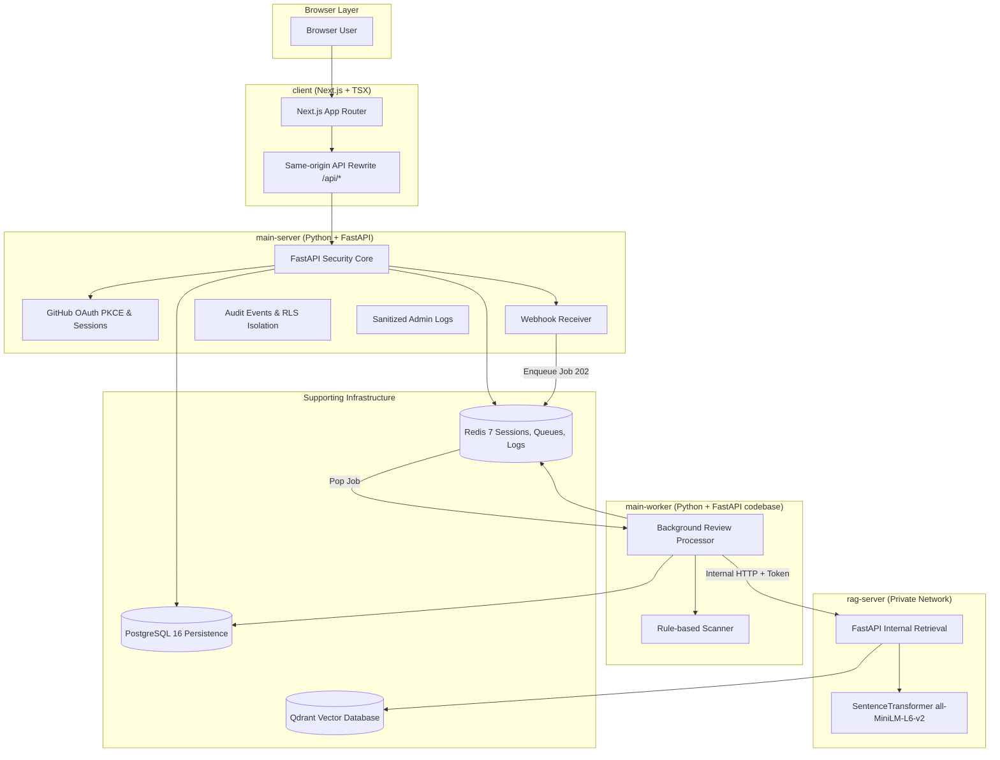

# CodeSecAudit AI Architecture

## 1. System Topology

## 2. Server Responsibilities

| Server | Tech Stack | Responsibilities |
|---|---|---|
| `client` | Next.js 14 + TSX | Product UI, SSR, same-origin API proxy, display-only log viewer |
| `main-server` | FastAPI + Python 3.11 | Security boundary, GitHub App/OAuth, PostgreSQL persistence, Redis sessions/queues/rate limits, admin logs |
| `main-worker` | FastAPI codebase | Asynchronous pull request review processing, diff fetching, static checks, guidance synthesis |
| `rag-server` | FastAPI + Python 3.11 | Private embedding, indexing, Qdrant vector search over OWASP cheat sheets |

## 3. Data Ownership & Storage Boundaries

- **PostgreSQL 16:** `users`, `organizations`, `memberships`, `github_installations`, `repositories`, `webhook_deliveries`, `review_jobs`, `reviews`, `findings`, `usage_events`, `audit_events`.
- **Redis 7:** `session:{id}` (opaque sessions), `rate:{scope}:{id}`, `webhook:{delivery-id}`, `queue:review`, `log:main-server`, `log:client`, `log:rag-server`.
- **Qdrant:** `secure_guidance_v1` collection containing OWASP guidance chunks and 384-dimensional dense vectors.
